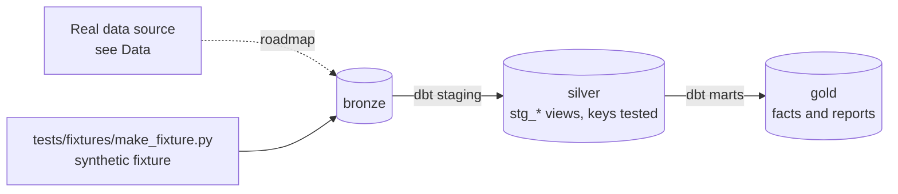

# Product Usage, Retention & Experiments

[](https://github.com/Saigwe/product-analytics-experiments/actions/workflows/ci.yml)

> Product analytics on raw app events: sessionisation, funnels, retention cohorts and DAU/MAU, plus an A/B testing kit with sample-ratio checks and CUPED, all defined once in dbt.

**Author:** Stanley Igwe, Lead Data (Analytics) Engineer · [Portfolio](https://saigwe.github.io)
**Stack:** BigQuery (sandbox) or DuckDB · dbt Core · Lightdash or Looker Studio · Python (statsmodels, scipy)
**Status:** 🚧 Scaffolded. Fixture pipeline passes: `dbt build` 18/18. See [Roadmap](#roadmap).

Project 8 of my portfolio plan. Consumer-electronics product analytics from my analytics engineering role at a consumer-audio company (keep claims in this README to what you can verify). This repo rebuilds the problem on public and synthetic data. No employer or client data, code or logic is used.

---

## 90-second summary
| | |
|---|---|
| **Problem** | TODO: one sentence on the business problem. |
| **What I built** | TODO: fill in as the roadmap lands. |
| **Why it matters** | TODO: the decision this enables, in the user's words. |
| **Proof** | TODO: link to [Numbers](#numbers), with every claim reproducible. |

## Architecture


## Data
Real data: the [Google Analytics 4 sample e-commerce dataset](https://developers.google.com/analytics/bigquery/web-ecommerce-demo-dataset) in the BigQuery public datasets (free sandbox). CI uses a synthetic users, events and experiment-assignment fixture.

| Bronze table (fixture) | Rows |
|---|---|
| `bronze.users` | 2,000 |
| `bronze.events` | 40,000 |
| `bronze.assignments` | 2,000 |

## Data model (gold layer, first cut)
| Model | Purpose |
|---|---|
| `rpt_retention_cohorts` | Weekly signup cohorts: share of each cohort active N weeks after signup. |
| `rpt_experiment_results` | Conversion (any purchase) by experiment variant. |

## Tests in place
- Staging: `unique` / `not_null` on every key, and `relationships` on every foreign key
- Marts: grain tests (`unique_combination`) and accepted values
- Business rules: `assert_no_sample_ratio_mismatch`, `assert_retention_is_a_percentage`

## Numbers
*(Fill from real runs. Never estimate.)*
| Metric | Value |
|---|---|
| Rows processed (real data) | _tbd_ |
| dbt models / tests | _tbd_ |
| `dbt build` runtime | _tbd_ |

## How to run
Requires **Python 3.12** (what CI uses) and `make`, or run the commands in the `Makefile` by hand.
```bash
python -m venv .venv && source .venv/bin/activate   # Windows: .venv\Scripts\activate
pip install -r requirements.txt
make fixture-all   # synthetic fixture -> dbt build (used in CI)
```

## Roadmap
- [x] Scaffold: synthetic fixture, staging with key tests, first marts and business-rule tests, CI
- [ ] Point the sources at the GA4 sample in BigQuery; keep the fixture for CI
- [ ] Sessionise events (30-minute inactivity) and model a user-day grain
- [ ] Funnels, D1/D7/D30 retention cohorts and DAU/MAU with one definition each
- [ ] Fold in project 9: sample-size calculator, sample-ratio-mismatch check, CUPED and guardrail metrics
- [ ] Simulate experiments with known effects and show the method recovers them
- [ ] Write-up: the one metric I'd move as product owner, and why
- [ ] Fill in [Numbers](#numbers) and the [design doc](docs/design_doc.md)
- [ ] 3-minute Loom walkthrough

## Interview topics this project prepares
- Product sense and metric design
- Sessionisation and retention SQL
- A/B testing and SRM
- Variance reduction (CUPED)

## Data and licence
- **Fixture:** synthetic, generated with a fixed seed by `tests/fixtures/make_fixture.py` from `fixture_spec.yml`. It describes no real company or person.
- **Real data:** see [Data](#data) for each source's own licence and terms.
- **Code:** MIT (see `LICENSE`).
