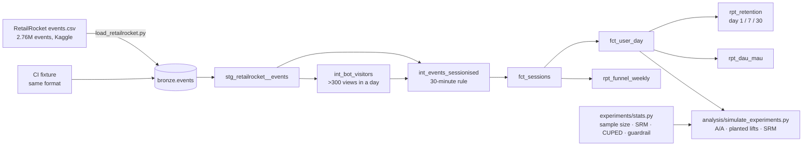

# Product Usage, Retention & Experiments

[](https://github.com/Saigwe/product-analytics-experiments/actions/workflows/ci.yml)

> Product analytics on 2.76 million real e-commerce events: sessions, funnel, retention cohorts and stickiness, defined once in dbt. Plus an A/B testing toolkit (sample size, sample-ratio checks, CUPED, guardrails), validated on 269,683 real visitors with A/A tests and planted effects.

**Author:** Stanley Igwe, Lead Data (Analytics) Engineer · [Portfolio](https://saigwe.github.io)
**Stack:** Python · DuckDB · dbt Core (unit tests) · NumPy / SciPy · pytest · GitHub Actions
**Status:** Core build complete on the full RetailRocket dataset. See [Roadmap](#roadmap).

This rebuilds the consumer product analytics from my analytics engineering role at a consumer-audio company, on public data. Projects 8 and 9 of my plan are combined here; no employer data is used.

---

## 90-second summary
| | |
|---|---|
| **Problem** | Product teams argue about "conversion" because every dashboard defines sessions, funnels and retention differently, and A/B tests get called on noise or on broken splits. |
| **What I built** | dbt models that define each metric once (sessions, funnel, day-N retention, DAU/MAU), with bot exclusion and reconciliation tests. A tested statistics toolkit. Simulations on real visitors that measure false positives, power and CUPED's effect. A product write-up on the one metric worth moving. |
| **Why it matters** | One trusted number per metric, and experiments that only declare winners that are real, sized for the traffic the site actually has. |
| **Proof** | 27 dbt checks pass on 2.76M events in 8.5 s. Planted lifts are recovered within 0.3 points, with 93–97% interval coverage. A 2% split error is caught (p = 2e-10). See [Numbers](#numbers). |

## Architecture


## Metric definitions (defined once)
- **Session:** a visitor's events with no gap over 30 minutes. A unit test pins the boundary: 29 minutes stays in the same session, 31 starts a new one.
- **Funnel:** sessions with a view → with an add-to-cart → with a purchase.
- **Day-N retention:** the share of a weekly cohort of new visitors active exactly N days after their first day. A cohort reports day N only once its last member has had N days.
- **Stickiness:** DAU ÷ 28-day active visitors.
- **Bots:** visitors who view more than 300 items in one day are excluded, and the exclusion is reported (`rpt_data_quality`). The rule is deliberately conservative. The heaviest real accounts (one made 559 purchases) look like business buyers, not crawlers, so they stay in.

## Experiment toolkit (`experiments/stats.py`, 6 known-answer tests)
- **`sample_size_per_arm`:** users needed per arm for a two-proportion test. Matches the textbook value: about 14,750 per arm for 10% → 11%.
- **`srm_check`:** chi-square test that the split matches what was intended.
- **`cuped`:** pre-period covariate adjustment. Unbiased, and the variance shrinks by corr².
- **`diff_in_means`:** Welch interval and p-value.
- **`guardrail`:** non-inferiority test (is the worst plausible change within the allowed margin?).

## Numbers
Full RetailRocket dataset (3 May – 18 Sep 2015) on a Windows laptop. Reproduce with `make all`.

| Metric | Value |
|---|---|
| Events / visitors | 2,756,101 / 1,407,580 (2,664,312 views, 69,332 add-to-carts, 22,457 transactions) |
| Load / `dbt build` | 0.3 s / 8.5 s, all 27 checks passing |
| Bot-like visitors excluded | 2 (0.06% of views) |
| Sessions | 1,761,473; 87% of visitors have exactly one |

**Funnel (all weeks):**

| View sessions | → Cart sessions | → Purchase sessions | View → cart | Cart → purchase | View → purchase |
|---|---|---|---|---|---|
| 1,755,581 | 43,919 | 14,294 | **2.50%** | 32.6% | 0.81% |

Weekly view → cart ranges from 2.26% to 2.84%. 2,365 purchase sessions have no add-to-cart logged in the same session (the cart was filled in an earlier session), so the funnel tests only enforce "view" as an upper bound.

**Retention and stickiness:** average day-1 retention is 2.8%, day 7 is 0.6% and day 30 is 0.2% (cohorts over 1,000 visitors). DAU averages 11,812 against 304,636 visitors active over 28 days, a stickiness of 3.9%. 685 of 11,718 buyers (5.8%) bought in more than one session.

**Experiment toolkit on real visitors** (269,683 active in the last 28 days; 500 simulations per row; [full results](results/experiments.md)):

| Planted lift | Estimated | CI coverage | Power, raw | Power, CUPED |
|---|---|---|---|---|
| Conversion +5% | +4.7% | 93% | 20% | 20% |
| Conversion +10% | +10.0% | 96% | 60% | 61% |
| Views per visitor +2% | +2.0% | 95% | 24% | 31% |
| Views per visitor +5% | +5.0% | 95% | 85% | **96%** |

What the simulations show:
- **The estimates are unbiased, and the intervals are honest.**
- **CUPED helps when the pre-period predicts the outcome.** Views correlate 0.58 with the pre-period, so CUPED narrows the interval by 18% and lifts power at +5% from 85% to 96%. For conversion (correlation 0.06) it does nothing.
- **A/A false-positive rates are 2.8% (conversion), 5.0% (views) and 6.8% (views with CUPED).** With 500 simulations the standard error is about 1 point, so 6.8% sits slightly high. Heavy-tailed buyer accounts are the likely cause; winsorising views is on the roadmap.
- **A 2% loss of treatment units is caught** (SRM p = 1.9e-10). There were no false alarms in 500 fair splits.
- **A 2% guardrail can't be verified at this traffic.** With no change applied, the guardrail still "fails": the noise (interval half-width about 0.06 views) is wider than the margin (0.034). A guardrail needs a margin the test can resolve, so widen it or run longer. That's exactly the kind of setting the toolkit should catch before launch.
- **Sample size:** at 0.78% conversion, detecting +10% needs 210k visitors per arm, about 6 weeks of traffic. Only a +20% lift is detectable within 28 days.

**Product write-up:** [the one metric I'd move](docs/product_writeup.md) is the add-to-cart rate per viewing session (2.5%). It's the leakiest funnel step, and tests on it need about 3× fewer units than tests on purchase conversion.

## How to run
Requires **Python 3.12** (what CI uses) and `make`, or run the commands in the `Makefile` by hand.
```bash
python -m venv .venv && source .venv/bin/activate   # Windows: .venv\Scripts\activate
pip install -r requirements.txt
make all            # needs data/raw/events.csv (see ingestion/README.md)
make fixture-all    # RetailRocket-format fixture (CI)
```

## Roadmap
- [x] Real event data (RetailRocket, chosen over the GA4 BigQuery sample so it needs no cloud account); CI fixture in the same format
- [x] Sessionisation, funnel, day-N retention, DAU/MAU, bot exclusion, with unit and reconciliation tests
- [x] Experiment toolkit (project 9): sample size, SRM, CUPED, Welch effects, guardrails
- [x] Simulations with known effects on real visitors; product write-up
- [ ] Delta-method variance for session-level metrics under visitor randomisation
- [ ] Winsorised views and sequential testing (always-valid p-values)
- [ ] Lightdash or Evidence dashboard on the gold models

## Interview topics this project prepares
- Product sense: choosing the metric to move, and why
- Sessionisation, funnels, retention cohorts and stickiness in SQL
- A/B testing: power, SRM, CUPED, guardrails and their pitfalls
- Validating statistical tooling with A/A tests and planted effects

## Data and licence
- **Data:** [RetailRocket e-commerce dataset](https://www.kaggle.com/datasets/retailrocket/ecommerce-dataset), licensed CC BY-NC-SA 4.0. It's anonymised (hashed ids, no prices). The raw file is not committed (`data/` is gitignored).
- **Code:** MIT (see `LICENSE`).
